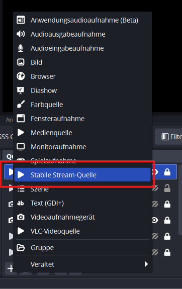

# Stable Stream Source for OBS Studio

An OBS Studio source for network streams (SRT, RTMP, RIST, UDP, HLS and anything else FFmpeg can open) that **keeps audio and video in sync after interruptions**.

*Deutsche Kurzfassung weiter unten.*

> **Status:** stable release 0.1.9, tested on OBS Studio 31.0.4 (Windows). [Download](https://github.com/glowf1sh/obs-stable-stream-source/releases/latest)

## Why this plugin exists

If you bring a live stream from the road into OBS (IRL streaming over mobile networks, a remote camera, a contribution feed), the connection will drop from time to time: a dead spot, the phone switching networks, a call coming in, the encoder restarting. With the built-in **Media Source**, the picture comes back after such a gap, but **audio and video are often out of sync** afterwards, typically by 0.2 to 0.5 seconds, sometimes more. The offset stays until you restart the source by hand.

This is a known limitation of OBS ([obs-studio#12724](https://github.com/obsproject/obs-studio/issues/12724)) and it is not caused by the sender or the server: the stream itself is still in sync.

## What causes it

When the stream continues after a gap, its timestamps jump: the sender starts a new session with new timestamps, or the timestamps continue with a gap.

The Media Source passes the stream timestamps on to OBS. OBS handles the jump differently for audio and video:

- **Audio:** if the timestamp jumps by more than 2 seconds, OBS re-anchors the audio to the current clock, at the moment the first audio after the gap arrives.
- **Video:** OBS keeps timing the video relative to its old anchor.

From then on audio and video have two different reference points. The difference between them depends on how long decoding and buffering took at that moment, which is the offset you see. Restarting the source sets both anchors together again, which is why that helps.

## What this plugin does differently

Stable Stream Source is the regular OBS Media Source, taken from OBS Studio 31.0.4, with one change in how network streams are timed:

1. The source paces the stream as before. Each audio and video frame is handed to OBS when it is due.
2. Instead of passing on the stream timestamps, the source gives every frame the time at which it is due on the computer clock. Audio and video use **the same pacing**, so their relative timing is taken from the stream and stays exactly as the sender produced it.
3. When the stream timestamps jump (gap, new session, reconnect), the pacing starts again from the current clock **for audio and video at the same moment**.

OBS never sees a timestamp jump, so its own re-anchoring of the audio is never triggered. The source does not need to be restarted and no scene switching tool has to "refresh" it. Local files are played exactly like in the Media Source.

## Features and settings

Everything the Media Source can do, with the same settings: local files and network URLs, input format, network buffering, reconnect delay, **hardware decoding**, restart on activate, close when inactive, speed, YUV color range, linear alpha, FFmpeg options and looping. Like the Media Source with a network stream, the source has no play/pause controls in OBS, which also keeps the toolbar quiet while the source waits for a stream.

### Hardware decoding

With hardware decoding, every video frame has to be copied back from the GPU, and the Media Source waits for that in the same thread that also paces the audio. A busy or power-saving GPU then delays the sound as well, which is heard as short dropouts every few seconds. For network streams with hardware decoding, Stable Stream Source decodes and copies the video in separate threads (both overlap) and keeps a small buffer of decoded frames. The audio never waits for the video, audio and video stay on the same clock, and short GPU stalls do not reach the picture. This adds 0.1 s of latency to the source. If the video decoding falls more than 0.2 s behind, it skips ahead to the next keyframe instead of drifting out of sync. If the GPU keeps falling behind, a software decoder starts in the background at the last keyframe, runs in parallel and takes over as soon as it delivers the next frame, without a gap. The switch is written to the OBS log. Software decoding and local files work exactly as before.

For SRT, set the latency in the URL (in microseconds, e.g. `latency=1000000` for 1 s) so lost packets can be retransmitted.

If your sender itself delivers audio and video with an offset (some cameras do), that offset is part of the stream. Correct it once with the audio sync offset in the OBS advanced audio properties.

## Compatibility

- OBS Studio 31.x (built against 31.0.4) on Windows (x64), macOS and Linux.
- Uses the FFmpeg libraries shipped with OBS, no extra installation needed.
- Works with any sender: smartphones, action cameras, hardware encoders and bonding solutions, as long as FFmpeg can open the stream.

## Installation

**Windows:** download the installer (`obs-stable-stream-source-<version>-windows-x64-installer.exe`) from the [Releases](https://github.com/glowf1sh/obs-stable-stream-source/releases) page and run it. It finds your OBS Studio folder, asks you to close OBS if it is still running, and installs the plugin. Running a newer installer later offers to update or uninstall. The plugin can also be removed under *Settings → Apps*.

**macOS and Linux:** download the package for your platform from the [Releases](https://github.com/glowf1sh/obs-stable-stream-source/releases) page and install it like any other OBS plugin.

Then add a source of type **Stable Stream Source** to your scene (in the German interface: *Stabile Stream-Quelle*). The version is shown at the bottom of the source properties.

## Building

The project is based on the official [OBS plugin template](https://github.com/obsproject/obs-plugintemplate). Builds for Windows, macOS and Linux run automatically on GitHub Actions. For local builds see the template documentation.

## Made by Glowfish

Stable Stream Source is developed and maintained by **[Glowfish GmbH & Co. KG](https://www.glowfish.de/en)**, a hosting provider from Munich, Germany. It grew out of our own IRL streaming infrastructure, where we run relays for live streaming over mobile networks.

Glowfish also offers:

- **[IRL streaming relays](https://www.glowfish.de/en/irl-streaming)**: SRT and SRTLA (bonding of several mobile connections), automatic scene switching for OBS and bitrate overlays, hosted by us or self-hosted on your own hardware
- **[Game servers](https://www.glowfish.de/en/spieleserver)**: Minecraft, Valheim, Factorio, Terraria, Project Zomboid and more
- **[vServers](https://www.glowfish.de/en/vserver)**: containers and virtual machines
- **[Web hosting](https://www.glowfish.de/en/webhosting)**

More at **[glowfish.de](https://www.glowfish.de/en)**.

## Code signing policy

Free code signing for the Windows installer is provided by [SignPath.io](https://about.signpath.io), certificate by [SignPath Foundation](https://signpath.org).

- Committers and reviewers: [glowf1sh](https://github.com/glowf1sh) (Glowfish GmbH & Co. KG)
- Approvers: [glowf1sh](https://github.com/glowf1sh) (Glowfish GmbH & Co. KG)

Only builds made by GitHub Actions from this repository are signed.

## Privacy

This plugin does not transfer any information to other networked systems unless specifically requested by the user. It only connects to the stream address entered in the source settings.

## License

GPL-2.0-or-later, see [LICENSE](LICENSE). Copyright © 2026 Glowfish GmbH & Co. KG.

---

## Deutsch: Kurzfassung

**Stable Stream Source** ist eine OBS-Quelle für Netzwerk-Streams (SRT, RTMP, RIST, UDP, HLS), die **Bild und Ton nach Unterbrechungen synchron hält**.

**Das Problem:** Reißt die Verbindung kurz ab, etwa durch ein Funkloch, einen Netzwechsel oder einen Anruf auf dem Handy, laufen in der normalen OBS-Medienquelle danach Bild und Ton oft um 0,2 bis 0,5 Sekunden auseinander. Das bleibt so, bis man die Quelle von Hand neu startet. Ursache: OBS richtet nach einem Zeitsprung im Stream den Ton neu an der aktuellen Uhrzeit aus, das Bild aber nicht.

**Die Lösung:** Die Quelle ist die normale OBS-Medienquelle aus OBS 31.0.4 mit allen Funktionen, auch Hardwaredekodierung. Geändert ist nur die Zeitgebung bei Netzwerk-Streams: Jedes Bild und jeder Ton bekommt die Uhrzeit, zu der er fällig ist, und zwar über **eine gemeinsame Taktung** für beide. Springen die Zeitstempel im Stream, beginnt diese Taktung für Bild und Ton gleichzeitig neu. OBS bekommt nie einen Zeitsprung zu sehen, Bild und Ton bleiben zusammen. Die Quelle muss dafür nicht neu gestartet werden.

**Hardwaredekodierung:** Bei Netzwerk-Streams mit Hardwaredekodierung dekodiert die Quelle das Bild in eigenen Abläufen mit einem kleinen Vorrat. Der Ton wartet nie auf die Grafikkarte, Bild und Ton bleiben auf derselben Taktung. Kurze Hänger der Grafikkarte erreichen das Bild nicht, dafür ist die Quelle 0,1 Sekunden später dran. Kommt die Grafikkarte dauerhaft nicht mit, startet im Hintergrund ein Software-Decoder und übernimmt ohne Lücke.

Liefert schon der Sender Bild und Ton versetzt (manche Kameras tun das), steckt der Versatz im Stream selbst. Den gleicht man einmalig mit dem Audio-Versatz in den erweiterten Audioeigenschaften von OBS aus.

**Einrichtung:** Unter Windows den Installer von der [Releases-Seite](https://github.com/glowf1sh/obs-stable-stream-source/releases) ausführen, er findet den OBS-Ordner selbst und kann später auch aktualisieren oder deinstallieren. Dann in der Szene über **+** eine Quelle vom Typ **Stabile Stream-Quelle** hinzufügen (siehe Bild oben) und die Stream-Adresse eintragen. Bei SRT die Latenz in der Adresse angeben, zum Beispiel `&latency=1000000` für 1 Sekunde.

**Von Glowfish:** Stable Stream Source wird von der **[Glowfish GmbH & Co. KG](https://www.glowfish.de)** aus München entwickelt. Außerdem bietet Glowfish an:

- **[IRL-Streaming-Relays](https://www.glowfish.de/irl-streaming)** mit SRT und SRTLA (Bündelung mehrerer Mobilfunkverbindungen), automatischer Szenenumschaltung für OBS und Bitrate-Overlays, bei uns gehostet oder selbst betrieben auf eigener Hardware
- **[Spieleserver](https://www.glowfish.de/spieleserver)** für Minecraft, Valheim, Factorio, Terraria, Project Zomboid und mehr
- **[vServer](https://www.glowfish.de/vserver)** als Container oder virtuelle Maschine
- **[Webhosting](https://www.glowfish.de/webhosting)**

Mehr auf **[glowfish.de](https://www.glowfish.de)**.
